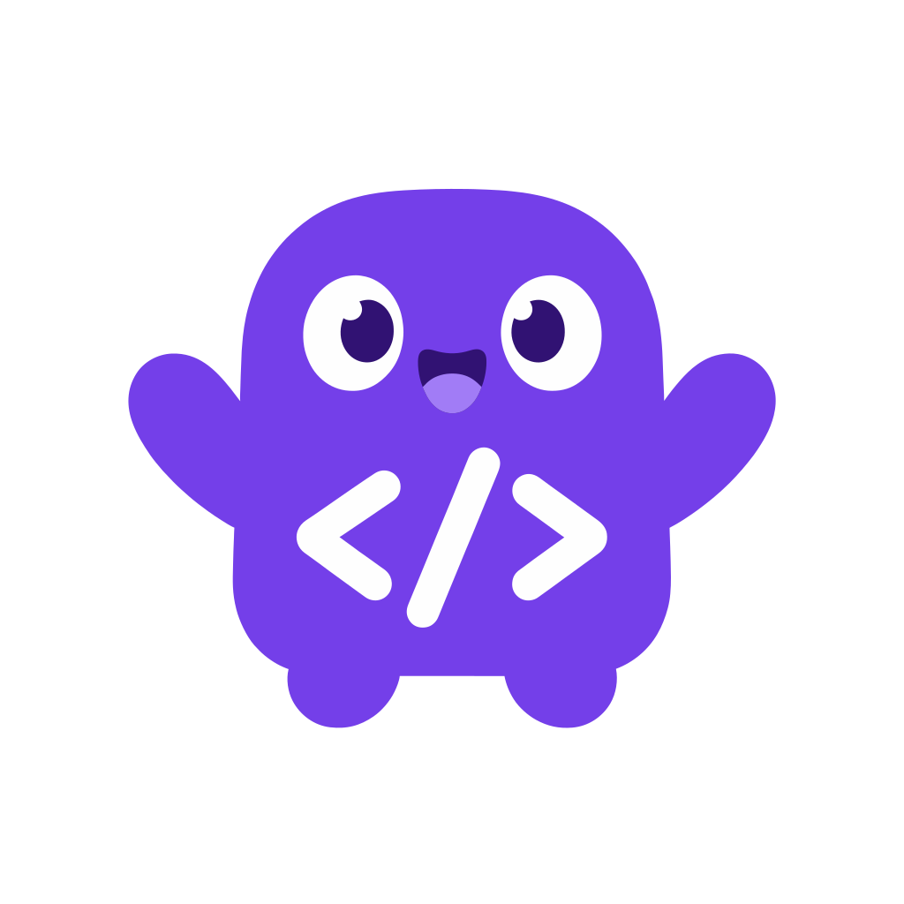

<p align="center">
  
</p>

<h1 align="center">Codequest</h1>

<p align="center">
  Aprenda programação no celular, uma etapa de cada vez.
</p>

---

O **Codequest** é um aplicativo Android para aprender a programar com uma trilha de etapas. Cada etapa começa com explicações animadas e depois traz exercícios de quatro tipos: escolher a resposta, completar o código, ordenar o código e escrever o código. A primeira trilha ensina **Python**, com 14 etapas que vão do `print` aos dicionários.

**Stack:** React Native 0.88 com TypeScript (Android), Supabase (Auth, Postgres e RLS) e React Navigation. O app fala direto com o Supabase, sem backend próprio.

> Estrutura do código, modelo de dados, testes manuais e a lista completa de problemas estão na [documentação técnica](docs/DOCUMENTACAO_TECNICA.md).

## Pré-requisitos

| Ferramenta | Versão |
| --- | --- |
| Node.js | 22.11+ (LTS recomendado) |
| JDK | 17 |
| Android Studio | Recente, com **Android SDK Platform 37**, Platform-Tools e Emulator |
| Supabase | Uma conta e um projeto (o plano gratuito basta) |

O Gradle baixa o Build Tools 37 e o NDK 27.1 no primeiro build, desde que as licenças do SDK estejam aceitas. O React Native CLI já está nas dependências, então não precisa instalar nada global.

Variáveis de ambiente necessárias para o build Android:

```bash
# macOS (~/.zshrc)
export ANDROID_HOME=$HOME/Library/Android/sdk
export PATH=$PATH:$ANDROID_HOME/platform-tools:$ANDROID_HOME/emulator
export JAVA_HOME=$(/usr/libexec/java_home -v 17)
```

No Windows, defina `ANDROID_HOME` como `%LOCALAPPDATA%\Android\Sdk`, `JAVA_HOME` como a pasta do JDK 17, e adicione `%ANDROID_HOME%\platform-tools` e `%ANDROID_HOME%\emulator` ao `Path`. Confira com `java -version` e `adb version`.

## Configuração

### 1. Clonar e instalar

```bash
git clone https://github.com/suuukii/projeto-integrado-mobile-codequest Codequest
cd Codequest
npm install
```

### 2. Criar o projeto no Supabase

1. Crie um projeto em [supabase.com](https://supabase.com/).
2. Em **Authentication > Sign In / Providers > Email**, desative **Confirm email** para poder entrar logo após o cadastro.

### 3. Aplicar as migrações

O schema, as políticas de RLS e todo o conteúdo da trilha estão em `supabase/migrations`. Execute os arquivos **em ordem**, colando cada um no **SQL Editor** do painel:

| # | Arquivo | O que faz |
| --- | --- | --- |
| 1 | `20261110000100_initial_schema.sql` | Tabelas, RLS e gatilho que cria o perfil |
| 2 | `20261110000200_seed_python_track.sql` | Trilha de Python com as 6 primeiras etapas |
| 3 | `20261111000300_lesson_cards.sql` | Cartões de explicação |
| 4 | `20261111000400_profile_avatar.sql` | Foto de perfil |
| 5 | `20261111000500_code_questions.sql` | Questões de completar e de ordenar |
| 6 | `20261112000600_code_input_questions.sql` | Questões de escrever e remoção de duplicadas |
| 7 | `20261113000700_more_python_stages.sql` | Etapas 7 a 14 |

As migrações 1 a 5 devem rodar **uma única vez**. A 6 e a 7 podem ser executadas de novo sem duplicar nada. No fim, a tabela `stages` tem 14 linhas.

Em um projeto **novo**, também dá para aplicar tudo de uma vez com o [Supabase CLI](https://supabase.com/docs/guides/cli):

```bash
supabase link --project-ref SEU-PROJECT-REF
supabase db push
```

Não use `db push` em um projeto onde as migrações já foram coladas no SQL Editor. O CLI não sabe que elas rodaram e tentaria aplicá-las de novo.

### 4. Configurar o `.env`

```bash
cp .env.example .env
```

| Variável | Onde encontrar |
| --- | --- |
| `SUPABASE_URL` | **Project Settings > Data API**, campo **Project URL** |
| `SUPABASE_PUBLISHABLE_KEY` | **Project Settings > API Keys**, chave `sb_publishable_...` |

Use apenas a chave **publishable**. Nunca coloque a `secret` ou a `service_role` no app. O `.env` está no `.gitignore` e é lido em tempo de build pelo `react-native-dotenv`, então qualquer mudança nele exige `npm start -- --reset-cache`.

## Rodando em desenvolvimento

Abra um emulador pelo **Device Manager** do Android Studio (ou `emulator -avd NOME`) e, em dois terminais:

```bash
npm start                               # Metro; deixe rodando
npm run android -- --active-arch-only   # build e instalação no emulador
```

O primeiro build leva alguns minutos, e os seguintes usam o cache do Gradle. Com o Metro rodando, as mudanças no código aparecem na hora (Fast Refresh). Para recarregar tudo, aperte **R** duas vezes no emulador. No Android 16 ou superior, o build de debug pede permissão de rede local na primeira abertura. Aceite para ele alcançar o Metro.

**Dispositivo físico:** ative a depuração USB, confira o aparelho em `adb devices`, rode `adb reverse tcp:8081 tcp:8081` e use o mesmo `npm run android`.

### Verificações

```bash
npm run typecheck
npm run lint
npm test
```

## Problemas comuns

| Sintoma | Solução |
| --- | --- |
| `SDK location not found` | Configure o `ANDROID_HOME` ou crie `android/local.properties` com `sdk.dir=...` |
| Gradle falha com erro de Java | O `JAVA_HOME` precisa apontar para o JDK 17 |
| `Unable to load script` | Suba o Metro com `npm start`. Em aparelho físico, rode também o `adb reverse` |
| `Variável de ambiente ausente` | `.env` faltando ou incompleto. Corrija e rode `npm start -- --reset-cache` |
| "Algo deu errado" no cadastro | Faltam migrações. Confira a tabela de migrações acima |
| "Confirme seu e-mail" após o cadastro | **Confirm email** está ativo no Supabase |
| `npm` bloqueado no PowerShell | `Set-ExecutionPolicy -Scope CurrentUser RemoteSigned` |

A lista completa está na [documentação técnica](docs/DOCUMENTACAO_TECNICA.md#solução-de-problemas).
