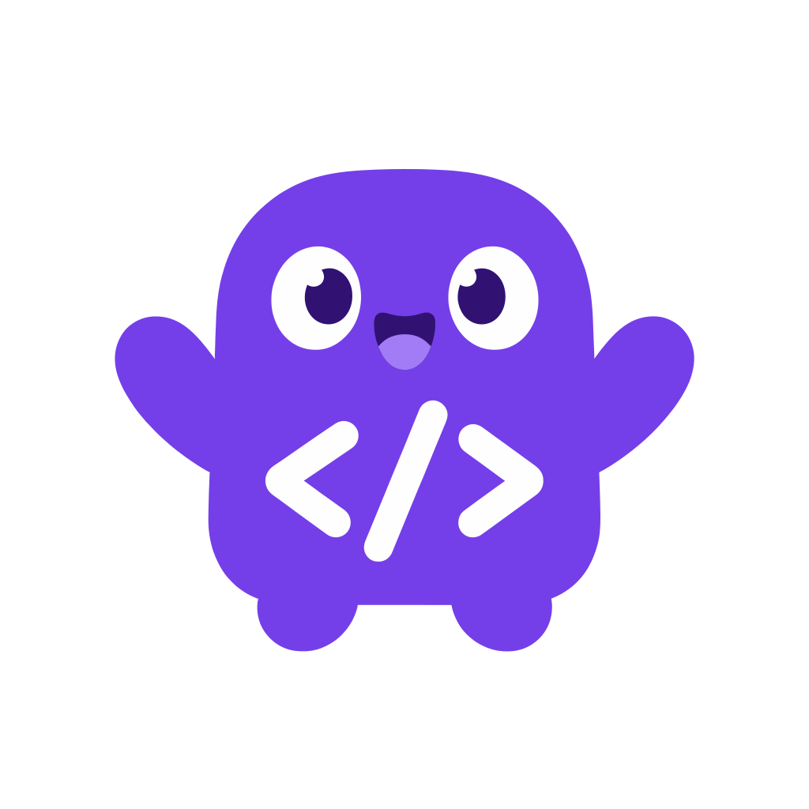

<p align="center">
  
</p>

<h1 align="center">Codequest</h1>

<p align="center">
  Aprenda programação no celular, uma etapa de cada vez.
</p>

---

O **Codequest** é um aplicativo Android para aprender a programar com uma trilha de etapas. Cada etapa começa com explicações animadas e depois traz exercícios de quatro tipos: escolher a resposta, completar o código, ordenar o código e escrever o código. A primeira trilha ensina **Python**, com 14 etapas que vão do `print` aos dicionários.

**Stack:** React Native 0.88 com TypeScript (Android), Supabase (Auth, Postgres e RLS) e React Navigation. O app fala direto com o Supabase, sem backend próprio.

## Por onde começar

| Eu quero... | Vá para |
| --- | --- |
| Rodar o app no meu computador | [Passo a passo](#passo-a-passo) |
| Gerar o APK ou AAB para distribuir | [Gerando a versão de release](#gerando-a-versão-de-release) |
| Resolver um erro | [Problemas comuns](#problemas-comuns) |
| Entender o código e o banco | [Documentação técnica](docs/DOCUMENTACAO_TECNICA.md) |

## Passo a passo

São cinco passos. Quem já recebeu as chaves do Supabase da equipe pode **pular o passo 3**.

### 1. Instale as ferramentas

| Ferramenta | Versão |
| --- | --- |
| Node.js | 22.11+ (LTS recomendado) |
| JDK | 17 |
| Android Studio | Recente, com **Android SDK Platform 37**, Platform-Tools e Emulator |

Depois configure as variáveis de ambiente que o build Android usa.

**Windows:**

- `JAVA_HOME`: a pasta do JDK 17
- `ANDROID_HOME`: a pasta do SDK (padrão `%LOCALAPPDATA%\Android\Sdk`)
- `Path`: adicione `%ANDROID_HOME%\platform-tools` e `%ANDROID_HOME%\emulator`

**macOS (`~/.zshrc`):**

```bash
export ANDROID_HOME=$HOME/Library/Android/sdk
export PATH=$PATH:$ANDROID_HOME/platform-tools:$ANDROID_HOME/emulator
export JAVA_HOME=$(/usr/libexec/java_home -v 17)
```

**Deu certo se** `java -version` mostra a versão 17 e `adb version` responde.

O Gradle baixa o Build Tools 37 e o NDK 27.1 sozinho no primeiro build, desde que as licenças do SDK estejam aceitas. O React Native CLI já vem nas dependências, então não é preciso instalar nada global.

> **⚠️ Windows: dois cuidados antes de continuar**
>
> O build nativo é sensível ao caminho das pastas. Ignorar estes pontos causa os dois erros mais comuns.
>
> 1. **Clone o projeto em um caminho curto**, como `C:\cq`. Em pastas longas o build falha com `Filename longer than 260`.
> 2. **O SDK não pode ficar em um caminho com espaços.** Se o seu usuário do Windows tem espaço no nome (`C:\Users\Nome Sobrenome`), crie um atalho sem espaços e aponte o `ANDROID_HOME` para ele:
>
>    ```bat
>    mklink /J C:\Android\Sdk "%LOCALAPPDATA%\Android\Sdk"
>    ```
>
>    Sem isso o build falha com vários `undefined symbol: std::__ndk1`.

### 2. Baixe o projeto

```bash
git clone https://github.com/suuukii/projeto-integrado-mobile-codequest Codequest
cd Codequest
npm install
```

No Windows, troque `Codequest` por um caminho curto, como `C:\cq`.

### 3. Prepare o Supabase (só para um projeto novo)

Pule este passo se a equipe já passou a URL e a chave do projeto: o banco já está pronto.

1. Crie um projeto em [supabase.com](https://supabase.com/) (o plano gratuito basta).
2. Em **Authentication > Sign In / Providers > Email**, desative **Confirm email**, para poder entrar logo após o cadastro.
3. Abra o **SQL Editor** e execute os arquivos de `supabase/migrations` **em ordem**, colando um de cada vez:

| # | Arquivo | O que faz |
| --- | --- | --- |
| 1 | `20261110000100_initial_schema.sql` | Tabelas, RLS e gatilho que cria o perfil |
| 2 | `20261110000200_seed_python_track.sql` | Trilha de Python com as 6 primeiras etapas |
| 3 | `20261111000300_lesson_cards.sql` | Cartões de explicação |
| 4 | `20261111000400_profile_avatar.sql` | Foto de perfil |
| 5 | `20261111000500_code_questions.sql` | Questões de completar e de ordenar |
| 6 | `20261112000600_code_input_questions.sql` | Questões de escrever e remoção de duplicadas |
| 7 | `20261113000700_more_python_stages.sql` | Etapas 7 a 14 |

As migrações 1 a 5 devem rodar **uma única vez**. A 6 e a 7 podem ser executadas de novo sem duplicar nada.

**Deu certo se** a tabela `stages` tem 14 linhas.

<details>
<summary>Alternativa: aplicar tudo de uma vez com o Supabase CLI</summary>

Em um projeto **novo**, também dá para usar o [Supabase CLI](https://supabase.com/docs/guides/cli):

```bash
supabase link --project-ref SEU-PROJECT-REF
supabase db push
```

Não use `db push` em um projeto onde as migrações já foram coladas no SQL Editor. O CLI não sabe que elas rodaram e tentaria aplicá-las de novo.

</details>

### 4. Crie o arquivo `.env`

```bash
cp .env.example .env
```

Abra o `.env` e preencha as duas variáveis:

| Variável | Onde encontrar no painel do Supabase |
| --- | --- |
| `SUPABASE_URL` | **Project Settings > Data API**, campo **Project URL** |
| `SUPABASE_PUBLISHABLE_KEY` | **Project Settings > API Keys**, chave `sb_publishable_...` |

Use apenas a chave **publishable**. Nunca coloque a `secret` ou a `service_role` no app. O `.env` está no `.gitignore`, então não vai para o repositório.

### 5. Rode o app

Abra um emulador pelo **Device Manager** do Android Studio (ou `emulator -avd NOME`). Depois, em **dois terminais** na pasta do projeto:

```bash
npm start
```

```bash
npm run android -- --active-arch-only
```

O primeiro comando sobe o Metro e deve ficar rodando. O segundo compila e instala o app no emulador. O primeiro build leva alguns minutos; os seguintes usam o cache do Gradle.

**Deu certo se** o app abre na tela de apresentação, com o mascote e os botões **Iniciar** e **Eu já tenho uma conta**.

**No dia a dia:**

- As mudanças no código aparecem na hora (Fast Refresh). Para recarregar tudo, aperte **R** duas vezes no emulador.
- Mudou o `.env`? Ele é lido em tempo de build, então reinicie o Metro com `npm start -- --reset-cache`.
- No Android 16 ou superior, o build de debug pede permissão de rede local na primeira abertura. Aceite para ele alcançar o Metro.

**Em um celular físico:** ative a depuração USB, confira o aparelho em `adb devices`, rode `adb reverse tcp:8081 tcp:8081` e use o mesmo `npm run android`.

## Verificações

Antes de enviar mudanças, rode:

```bash
npm run typecheck
```

```bash
npm run lint
```

```bash
npm test
```

## Gerando a versão de release

O release é a versão para distribuir. Ele usa o `.env` de produção (lido em tempo de build), é ofuscado e reduzido pelo R8 e é assinado com a keystore definitiva.

**1. Gere a keystore (uma única vez).** O comando pede uma senha e alguns dados de identificação:

```bash
keytool -genkeypair -v -storetype PKCS12 -keystore android/app/codequest-release.keystore -alias codequest -keyalg RSA -keysize 2048 -validity 10000
```

> **Guarde a keystore e a senha em local seguro.** Sem elas não é possível publicar atualizações do app.

**2. Informe as senhas ao build.** Copie `android/keystore.properties.example` para `android/keystore.properties` e preencha. Esse arquivo e a keystore não vão para o git.

**3. Gere o pacote.** Dentro da pasta `android`:

| Para | Comando | Onde sai |
| --- | --- | --- |
| Instalar direto ou distribuir (APK) | `./gradlew app:assembleRelease` | `app/build/outputs/apk/release` |
| Publicar na Play Store (AAB) | `./gradlew app:bundleRelease` | `app/build/outputs/bundle/release` |

Bom saber:

- Sem o `keystore.properties`, o release é assinado com a chave de debug e serve apenas para testes.
- Um APK com assinatura diferente não instala por cima do anterior. Desinstale o app antes.

## Problemas comuns

| Sintoma | Solução |
| --- | --- |
| `Filename longer than 260` | No Windows, clone o projeto em um caminho curto, como `C:\cq` |
| `undefined symbol: std::__ndk1...` | No Windows, o `ANDROID_HOME` aponta para um caminho com espaços |
| `SDK location not found` | Configure o `ANDROID_HOME` ou crie `android/local.properties` com `sdk.dir=...` |
| Gradle falha com erro de Java | O `JAVA_HOME` precisa apontar para o JDK 17 |
| `Unable to load script` | Suba o Metro com `npm start`. Em aparelho físico, rode também o `adb reverse` |
| `Variável de ambiente ausente` | `.env` faltando ou incompleto. Corrija e rode `npm start -- --reset-cache` |
| "Algo deu errado" no cadastro | Faltam migrações. Confira a tabela do passo 3 |
| "Confirme seu e-mail" após o cadastro | **Confirm email** está ativo no Supabase |
| `npm` bloqueado no PowerShell | `Set-ExecutionPolicy -Scope CurrentUser RemoteSigned` |

A lista completa está na [documentação técnica](docs/DOCUMENTACAO_TECNICA.md#solução-de-problemas).
